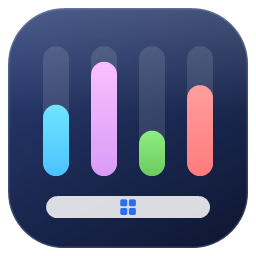
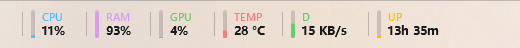

<div align="center">



# Taskbar Widgets

**Vos indicateurs système, directement dans la barre des tâches de Windows 11.**

CPU · RAM · GPU · température · débit réseau, et vos propres widgets en C#.

[](#prérequis)
[](https://dotnet.microsoft.com/)
[](#fonctionnement)
[](#écrire-un-widget)
[](LICENSE)



</div>

---

## Table des matières

- [Points forts](#points-forts)
- [Prérequis](#prérequis)
- [Compiler et lancer](#compiler-et-lancer)
  - [Version distribuable : `dist\`](#version-distribuable--dist)
- [Utilisation](#utilisation)
- [Configuration](#configuration)
- [Écrire un widget](#écrire-un-widget)
- [Fonctionnement](#fonctionnement)
- [Structure](#structure)
- [Licence](#licence)

## Points forts

- 📊 **Widgets intégrés** : processeur, mémoire, GPU, température, réception et envoi réseau.
- 🧩 **Plugins** : une DLL .NET dérivant de `TaskbarWidget` suffit pour ajouter un widget.
- 🖥️ **Multi-écran** : affichage sur la barre des tâches de l'écran de votre choix.
- ⚡ **Configuration en direct** : `settings.json` est appliqué dès son enregistrement.
- 🌗 **Thème clair / sombre** suivi automatiquement, masquage en plein écran.
- 🪶 **Léger** : environ 0,3 % d'un cœur processeur en fonctionnement.
- 📦 **Autonome** : un seul `.exe`, runtime .NET inclus, rien à installer.

## Prérequis

- Windows 11 (fonctionne aussi sous Windows 10)
- SDK .NET 10

## Compiler et lancer

```bash
dotnet build -c Release
```

```bash
src/TaskbarWidgets/bin/Release/net10.0-windows/TaskbarWidgets.exe
```

### Version distribuable : `dist\`

```bash
pwsh tools/publish.ps1
```

Le script régénère `dist\` à la racine : `TaskbarWidgets.exe` est un exécutable **autonome en un seul fichier**
(runtime .NET inclus, rien à installer). Copiez le dossier où vous voulez et lancez l'exe.
Le plugin d'exemple (durée de fonctionnement) est placé dans `dist\Widgets\` ; ajoutez `-NoSample` pour l'exclure.

## Utilisation

- **Clic droit** sur les widgets : activer/désactiver chaque widget, position (gauche/droite, décalage),
  écran (barre des tâches de n'importe quel écran ; nécessite « Afficher ma barre des tâches sur tous les écrans »),
  lancement au démarrage de Windows, édition de `settings.json`, rechargement, quitter.
- **Clic gauche** sur un widget système : ouvre le Gestionnaire des tâches.
- **Survol** : détails (zones thermiques, cartes réseau, mémoire utilisée…).

Les widgets sont masqués automatiquement quand la barre est masquée (masquage automatique)
ou qu'une application passe en plein écran, et se réattachent si `explorer.exe` redémarre.
Le thème clair/sombre de la barre est suivi.

## Configuration

`%APPDATA%\TaskbarWidgets\settings.json` (créé au premier lancement). **Les modifications sont appliquées
en direct** dès l'enregistrement du fichier (sans scrutation : Windows prévient l'application). Seuls les widgets
dont la configuration change sont redémarrés. Un fichier invalide (édition en cours) est ignoré, jamais écrasé.
Ajouter une nouvelle DLL de plugin demande en revanche « Recharger » dans le menu.

```jsonc
{
  "screen": "\\\\.\\DISPLAY2", // écran qui accueille les widgets ; absent = écran principal
  "anchor": "Left",          // Left : après le bouton Widgets de Windows ; Right : avant la zone de notification
  "offset": 70,              // distance au bord, en pixels logiques (DIP)
  "hideOnFullscreen": true,
  "widgets": [               // ordre d'affichage
    { "id": "cpu", "enabled": true },
    { "id": "ram", "enabled": true, "color": "#E39FF6" },
    { "id": "gpu", "enabled": true },
    { "id": "temp", "enabled": true },
    { "id": "net-down", "enabled": true, "label": "↓", "options": { "interface": "Wi-Fi" } },
    { "id": "net-up", "enabled": false }
  ]
}
```

| Id | Widget | Source |
|---|---|---|
| `cpu` | Utilisation processeur | compteur `Processor Information\% Processor Utility` (comme le Gestionnaire des tâches) |
| `ram` | Mémoire physique utilisée | `GlobalMemoryStatusEx` |
| `gpu` | Moteur GPU le plus chargé | compteurs `GPU Engine` |
| `temp` | Température maximale des zones ACPI | compteurs `Thermal Zone Information` |
| `net-down` / `net-up` | Débit réseau reçu / envoyé | compteurs `Network Interface` |

Options réseau : `interface` (ne compter que les cartes dont le nom contient ce texte),
`includeVirtual` (`"true"` pour inclure Hyper-V, VPN…).

> La température vient des zones thermiques exposées par le firmware (lisibles sans droits administrateur).
> Selon la carte mère, ce n'est pas forcément la température du cœur du processeur, et certaines machines
> n'en exposent aucune (le widget affiche alors « N/A »).

Les erreurs sont journalisées dans `%APPDATA%\TaskbarWidgets\log.txt`.

## Écrire un widget

1. Créez une bibliothèque de classes `net10.0-windows` avec `<UseWPF>true</UseWPF>`.
2. Référencez `TaskbarWidgets.Sdk` **sans le copier** (`Private="false"`) : il est fourni par l'application.
3. Dérivez de `TaskbarWidget` :

```csharp
using System.Windows.Media;
using TaskbarWidgets.Sdk;

public sealed class HelloWidget : TaskbarWidget
{
    public override string Id => "hello";                 // clé dans settings.json
    public override string DisplayName => "Bonjour";      // nom dans le menu
    public override string DefaultLabel => "HELLO";       // petit libellé coloré
    public override Color DefaultAccent => Colors.Orange;
    public override TimeSpan UpdateInterval => TimeSpan.FromSeconds(5);

    public override void Initialize(WidgetContext context) { /* options : context.GetOption("clé") */ }

    public override void Update()                          // thread d'arrière-plan
    {
        Value = DateTime.Now.ToString("HH:mm");           // texte principal
        Level = DateTime.Now.Minute / 60.0;               // barre verticale 0..1 (null = vide)
        ToolTip = "Info-bulle";
    }
}
```

4. Copiez la DLL dans `%APPDATA%\TaskbarWidgets\Widgets\` (menu « Ouvrir le dossier des plugins »)
   ou dans le dossier `Widgets\` à côté de l'exécutable, puis « Recharger ».

Pour aller plus loin :
- `CreateView()` : renvoyez votre propre `FrameworkElement` WPF (son `DataContext` est le widget) ;
- `OnClick()` : action au clic gauche ;
- `MinValueWidth`, `DefaultOrder`, `EnabledByDefault` ;
- `PdhQuery` : lecture simple des compteurs de performance Windows (chemins anglais, indépendants de la langue).

Exemple complet : [samples/TaskbarWidgets.Sample.Uptime](samples/TaskbarWidgets.Sample.Uptime) (il se copie
automatiquement dans le dossier `Widgets` de l'application à chaque compilation).

## Fonctionnement

Windows 11 ne propose pas d'API pour ajouter du contenu dans la barre des tâches (les « deskbands » ont disparu).
L'application crée donc une fenêtre WPF transparente, sans bouton ni entrée Alt+Tab, qui ne prend jamais le focus,
et la pose sur la barre :

- la fenêtre est **possédée par `Shell_TrayWnd`**, ce qui la maintient au-dessus de la barre même quand on clique dessus ;
- toutes les 500 ms, elle suit la position, la hauteur et le DPI de la barre, et se masque en plein écran
  (`SHQueryUserNotificationState`) ou quand la barre se masque ;
- le message `TaskbarCreated` signale un redémarrage d'`explorer.exe`.

Si l'écran choisi est débranché ou n'a plus de barre des tâches, les widgets reviennent sur l'écran principal
(et retournent sur l'écran choisi dès qu'il réapparaît). En plein écran, seuls les widgets de l'écran concerné sont masqués.

Limite connue : le décalage gauche (`offset`) est commun à tous les écrans ; il est à ajuster
si le bouton Widgets de Windows affiche la météo (il est alors plus large) ou si les icônes sont alignées à gauche.

## Structure

```
src/TaskbarWidgets.Sdk/     API des widgets (TaskbarWidget, WidgetContext, PdhQuery, Units)
src/TaskbarWidgets/         application hôte WPF + widgets intégrés
samples/…Sample.Uptime/     exemple de plugin
tools/publish.ps1           génère dist\ (exécutable autonome prêt à l'emploi)
tools/make-icon.ps1         génère l'icône de l'exécutable (src/TaskbarWidgets/Assets/TaskbarWidgets.ico)
```

## Licence

Distribué sous licence [MIT](LICENSE).
